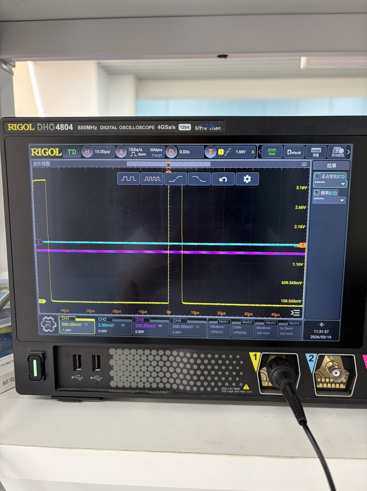
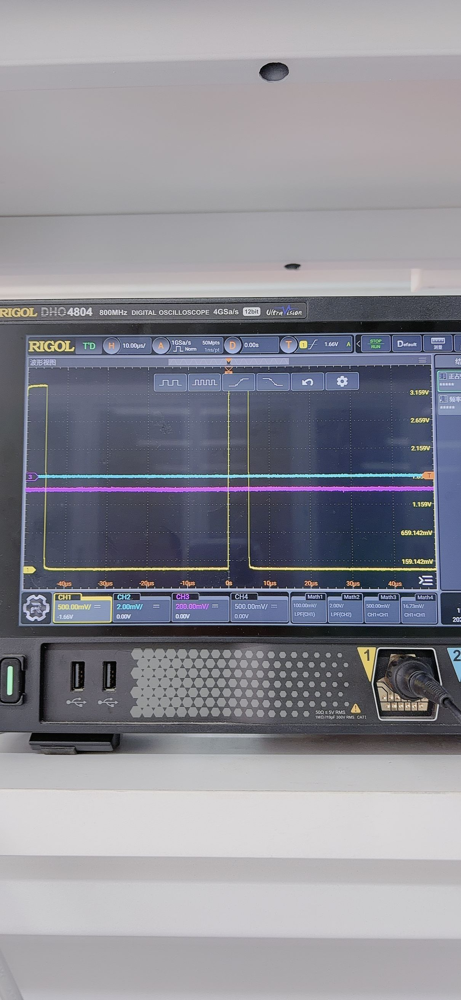

# FPGA 四路控制输出实板测试记录

日期：2026-09-19。执行：B线成员现场操作；记录依据：本次对话中的示波器照片与用户逐项反馈。程序下载、按键和探头操作由用户完成，本记录不声称由自动化工具现场测量。

## 环境与范围

- Tang Primer 20K + Dock，测试工程 `board/dock_motor_test.gprj`。
- 用户确认下载文件为 `D:\FPGA\hengxin\motor-dev\fpga\motor\board\impl\pnr\dock_motor_test.fs`，USB-JTAG / SRAM Program。未记录实际下载位流哈希，不能作精确版本追溯。
- RIGOL DHO4804，CH1，用户确认探头开关与通道倍率均为10X，输入1 MΩ、直流耦合。用两根公对公线分别引出信号与GND；四路逐一换线测试。每次换板端接线先断电，重新上电后重新下载SRAM程序。
- 仅测FPGA端输出；未接电平转换器、IBT-2、电机和倒立摆。正反向均为逻辑方向。

| 信号 | PMOD0 FPGA管脚 |
|---|---|
| RPWM | T6 |
| LPWM | P6 |
| R_EN | T7 |
| L_EN | R8 |

S1启动，S2普通停止，S3选择方向并停止，S0复位。LED2表示可启动，LED4表示运行，LED5表示反向选择。S2不是独立硬件急停。

## 结果

| 测试项 | 现场结果 | 证据 |
|---|---|---|
| RPWM正向运行 | 周期脉冲 | 下方RPWM照片 |
| RPWM停止、反向运行 | 接近0 V，无脉冲 | 用户逐项确认 |
| LPWM反向运行 | 周期脉冲 | 下方LPWM照片 |
| LPWM停止、正向运行 | 接近0 V，无脉冲 | 用户逐项确认 |
| R_EN待机、S3只选择方向 | 约0 V | 用户确认 |
| R_EN正向及反向运行 | 约3.3 V稳定电平 | 用户确认 |
| R_EN两方向普通停止 | 回到约0 V | 用户确认 |
| L_EN待机、S3只选择方向 | 约0 V | 用户确认 |
| L_EN正向及反向运行 | 约3.3 V稳定电平 | 用户确认 |
| L_EN两方向普通停止 | 回到约0 V | 用户确认 |
| L_EN运行时按住S0 | 输出降至约0 V，LED2/4/5灭 | 用户确认 |
| L_EN松开S0等约2秒 | 只有LED2亮，输出保持约0 V，不自动启动 | 用户确认 |
| R_EN运行时按住S0 | 输出降至约0 V | 用户确认 |
| R_EN松开S0等约2秒 | 只有LED2亮，输出保持约0 V，不自动启动 | 用户确认 |

从两张波形照片按刻度粗估：周期约50 μs（约20 kHz），高电平宽度约5 μs（约10%占空比），高电平约3.3 V、低电平接近0 V。不是仪器导出的精确读数，也未给出误差范围。屏幕右侧C2测量项不是CH1结果，不能引用其星号或读数作为本次信号的测量值。

## 波形照片

以下为用户提供的原始照片，未裁剪或修改。照片记录稳定运行状态；停止、使能及复位结果仅有用户反馈，没有单独波形截图。

### RPWM：逻辑正向

### LPWM：逻辑反向

## 调试过程与限制

- 曾出现下载器未识别；USB-OTG误接是用户提出的可能原因，不能据此断言全部异常均由接口误接导致。下载使用USB-JTAG。
- 后续出现`User code mismatch`且只有LED0/1亮。核对核心板使能拨码后，后续截图不再显示该警告；期间曾选到另一路径下的位流，最终选回上述测试文件并恢复LED2待机。本过程不作为单一故障原因的严格验证。
- 核心板使能开关是带五个白色拨杆的大红色拨码组件，1号位按官方说明使能。对话中曾将LED旁的小红色元件误认为开关，已纠正，不能按该错误描述操作。参考[Sipeed使能说明](https://wiki.sipeed.com/hardware/en/tang/tang-primer-20k/start.html#Enable-Core-Board)。
- 初期有一张幅度明显偏低的PWM照片，未计入通过证据，原因未单独确认；这里仅附后续正常幅度的照片。
- SRAM配置在断电后丢失；重新上电的轮流亮灯不能代表测试程序恢复，必须重新下载并核对LED2待机。
- 逐路稳态检查通过不等于动态互斥验证通过。尚未测两路同时采集的换向重叠、毛刺、关断延迟、复位响应时间、配置/掉电期间电平或故障恢复。
- 本轮未直接测RPWM/LPWM复位瞬间波形；R_EN/L_EN复位检查只确认人工观察到的电平与不自动启动行为。
- 尚未测转换后5 V信号、OE及外部下拉、硬件急停/许可、驱动器、电机电流温升、机械方向与闭环控制。测试顶层permit固定1，不应作为最终电机安全顶层。

## 后续

核对电平转换板排针焊接、供电、OE与外部下拉，再进行转换后四路信号验证；电机联调需另行完成。

关联：[按键与LED记录](BOARD_TEST_2026-09-18.md)、[板级工程](BOARD_STEP.md)、[同步器和复位约束](CDC_RESET_REVIEW.md)。
